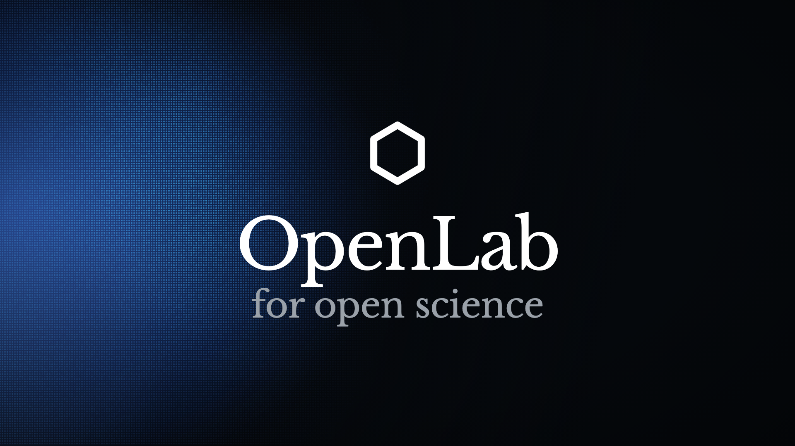

<p align="center">
  
</p>

# openlab

**The research workbench.** An agent you can watch, a real workspace, and every result you can reproduce.

openlab is the ScienceDelta desktop app for the parts of research that are real work but not the idea: pulling and cleaning data, reproducing a claim, sweeping a parameter, drafting the methods section, checking a reference.

## What it is

- **A session, not a chat box.** Each session is an experiment with a folder, a branch and a phase.
- **Every step is on the record.** A turn shows what the model thought, what it ran and what changed.
- **Your model, your terms.** No vendor is baked in. Bring a key, point at a lab server, or run a local model.
- **Reproducible by construction.** Statistical results come back with the R and Python that recompute them, and every procedure declares what it consumes and how to verify its output.

## Download

Installers for macOS, Windows and Linux are published on the [releases page](https://github.com/sciencedeltacom/openlab/releases/latest).

| Platform | Build |
| --- | --- |
| macOS | Apple silicon and Intel |
| Windows | x64 |
| Linux | x64 |

The app checks the same releases page for updates. Builds are signed when a signing identity is configured.

## Getting started

To run from source, install Bun, Rust 1.90 or newer, and the platform webview. The credential vault needs libsodium and pkg-config; on macOS, `brew install libsodium pkg-config`.

```bash
# From apps/openlab
bun install
bun run tauri dev
```

`tauri dev` starts Vite on port 1420 and then the Tauri shell. In the monorepo, `bun run dev:openlab` from the repository root does the same.

The terminal build uses the same store, workspace and statistical engine:

```bash
bun run cli status
bun run cli chat "clean data/raw.csv and plot the dose response"
bun run cli analyze statistics ttest --a 5.1,4.9,6.2 --b 4.2,4.4,3.9 --code
```

See [`cli/README.md`](./cli/README.md) for the command list.

## Repository layout

| Folder | What lives there |
| --- | --- |
| `src/` | The interface, the store, the agent and the science engine. |
| `src-tauri/` | The Rust shell: files, git, credentials, SQLite and the scan worker. |
| `cli/` | The same workbench in the terminal. |
| `drizzle/` | The SQLite schema and its migrations. |
| `scripts/` | The verification suite and the release resource build. |
| `e2e/` | Browser tests against the built bundle. |

## Development

```bash
bun run typecheck
bun run verify:web
cargo test --manifest-path src-tauri/Cargo.toml --lib
bun run build
```

`verify:web` runs the whole verification suite. `verify:science` checks the statistics against SciPy.

## Acknowledgements

Some bundled procedures are adapted from [Scientific Agent Skills](https://github.com/K-Dense-AI/scientific-agent-skills) by K-Dense Inc. (MIT). If they contribute to published work, cite Kassis, Agarwal, He, Patel and Brueckner, *Scientific Agent Skills: A Library of Procedural Knowledge for Research Agents* (2026), https://arxiv.org/abs/2609.00065.

Funnel Display and Libre Baskerville are under the SIL Open Font License; their notices are in [`public/fonts`](./public/fonts).

## Licence

MIT. See [`LICENSE`](./LICENSE).
